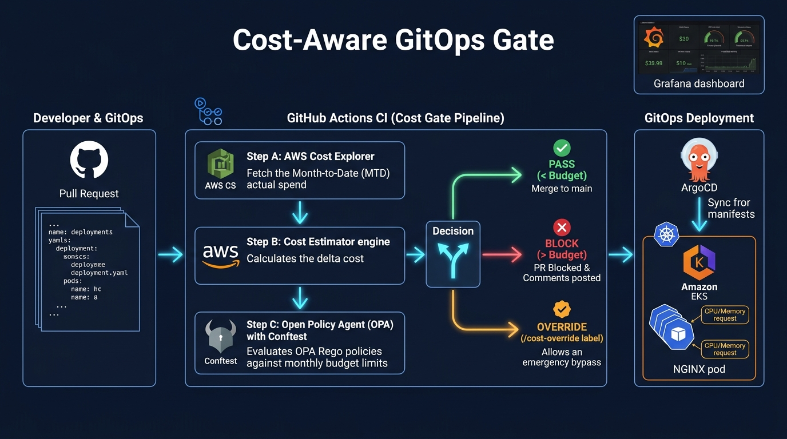

# Cost-Aware GitOps Gate

> A DevOps + FinOps enforcement gate for Amazon EKS that estimates the cost impact of Kubernetes manifest changes during pull-request validation, compares projected spend with namespace budgets, and blocks unauthorized budget-breaching deployments before ArgoCD synchronizes them to the cluster.

---

## Architecture




## Gate Decisions

| Decision | Condition |
|---|---|
| ✅ **PASS** | Cost data is fresh and the evaluated forecast is within budget |
| ❌ **BLOCK** | Cost data is missing/stale, required inputs are invalid, or the evaluated forecast exceeds budget |
| ⚠️ **PASS WITH OVERRIDE** | Over budget with a valid GitHub approval from an authorized approver |

The evaluated forecast is the higher of the projected end-of-month spend and the
steady-state monthly run-rate. This is intentionally conservative. The estimator
reports both values in `data/cost_report.json`.

## Repository Structure

```
├── infrastructure/          # Terraform: VPC, EKS, IAM, S3/DynamoDB backend
├── manifests/               # Kubernetes manifests (ArgoCD source of truth)
├── config/
│   ├── budgets.yaml         # Per-namespace monthly budget limits
│   └── pricing.yaml         # CPU/memory hourly rates (versioned)
├── policies/
│   └── cost_gate.rego       # OPA Rego budget policy
├── scripts/
│   ├── bootstrap_tf_backend.py  # One-time S3+DynamoDB backend setup
│   ├── ingest_costs.py          # AWS Cost Explorer → data/costs.json
│   ├── estimate_cost.py         # Manifest diff → data/cost_report.json
│   └── report.py                # Phase 8: estimated vs actual comparison
├── grafana/
│   ├── dashboard.json       # Grafana dashboard (import via UI)
│   └── push_metrics.py      # Prometheus metrics exporter
├── tests/                   # Conftest test scenarios (pass/fail/override)
├── argocd/
│   └── application.yaml     # ArgoCD Application CRD
└── .github/workflows/
    └── cost-gate.yaml       # GitHub Actions CI workflow
```

---

## Quick Start

### Prerequisites

- AWS account with Cost Explorer enabled and permission to read cost data
- Terraform ≥ 1.5, AWS CLI, kubectl, Helm, Python 3.10+, OPA, Conftest
- GitHub repository with Actions enabled
- GitHub Actions OIDC configured by Terraform
- AWS billing alert or AWS Budget configured as a safety net

### 1. Bootstrap Terraform Backend

```bash
# Creates S3 bucket + DynamoDB table for Terraform state
pip install boto3
python scripts/bootstrap_tf_backend.py \
  --bucket cost-gate-tf-state \
  --table  cost-gate-tf-locks \
  --region us-east-1
```

### 2. Provision EKS Infrastructure

```bash
cd infrastructure
cp terraform.tfvars.example terraform.tfvars
# Edit terraform.tfvars: set github_repo = "your-username/cost-aware-gitops-gate"

terraform init
terraform plan
terraform apply
```

### 3. Configure kubectl

```bash
# Use the output from terraform apply:
aws eks update-kubeconfig --region us-east-1 --name cost-gate-demo
kubectl get nodes
```

### 4. Install ArgoCD

```bash
helm repo add argo https://argoproj.github.io/argo-helm
helm repo update
kubectl create namespace argocd
helm install argocd argo/argo-cd -n argocd \
  --set server.service.type=LoadBalancer \
  --wait

# Get initial admin password:
kubectl -n argocd get secret argocd-initial-admin-secret \
  -o jsonpath="{.data.password}" | base64 -d
```

### 5. Deploy ArgoCD Application

```bash
# Update argocd/application.yaml with your GitHub repo URL first
kubectl apply -f argocd/application.yaml
```

### 6. Configure GitHub Secrets

In your GitHub repository, add:
| Secret | Value |
|---|---|
| `AWS_ROLE_ARN` | Output of `terraform output github_oidc_role_arn` |
| `AWS_REGION` | `us-east-1` |

### 7. Enable Branch Protection

In GitHub → Settings → Branches → `main`:
- ✅ Require status checks to pass: `cost-gate / 💰 Cost Gate`
- ✅ Require branches to be up to date before merging

---

## Demonstration Scenarios

### Scenario A — Within Budget (PR passes)
Edit `manifests/checkout-deployment.yaml`: change `replicas: 2` → `replicas: 3`

### Scenario B — Budget Breach (PR blocked)
Edit replicas to `6`, CPU to `500m`, memory to `1Gi`

### Scenario C — Approved Exception (Secure PR Override)
To prevent developers from self-approving exceptions in manifest YAMLs, overrides are
secured through GitHub metadata:
1. Apply the `cost-override` or `budget-override` label to the pull request.
2. An authorized approver listed in `config/budgets.yaml` approves the pull request review.
3. The workflow verifies the review through the GitHub API.
4. Only then does the workflow pass approval metadata to the estimator.

An empty or missing approver allowlist is invalid and cannot authorize an override.
The Rego policy also rejects malformed or unauthorized override metadata.

---

## Running Automated Unit & Policy Tests

Run the built-in regression test suite:

```bash
python -m unittest discover tests
```

Run the Rego policy tests separately:

```bash
opa test policies
```

Tests cover:
- Kubernetes CPU & Memory unit parsers (millicores, binary units, negative validation)
- Manifest schema validation (Deployment kind, namespace matching, limits fallback)
- FinOps forecast models (prorated EOM spend and steady-state monthly run-rate)
- Fail-closed data health checks (missing files, stale timestamps > 48h)
- Cost Explorer UTC calendar range calculations and environment filters
- Apples-to-apples time-window normalization for actuals comparison
- Unauthorized overrides and empty approver allowlists

---


## Cost Estimation Formula

```
monthly_cost = replicas × cpu_cores × $0.04/core-hour × 730h
             + replicas × memory_GiB × $0.005/GiB-hour × 730h
```

> ⚠️ **Approximation only.** Shared node, EKS control-plane ($0.10/hr), storage, network, autoscaling, and discount costs are not included. See `config/pricing.yaml`.

---

## Phase 8 — Actuals Comparison

Capture a baseline before the deployment:

```bash
python scripts/ingest_costs.py team-checkout team-search --environment production
cp data/costs.json data/costs_before.json
```

After 24–48 hours (to allow Cost Explorer data to propagate), capture the second
snapshot:

```bash
# Fetch post-deployment costs for the same environment
python scripts/ingest_costs.py team-checkout team-search --environment production
cp data/costs.json data/costs_after.json

# The actuals report expects the estimate's pre-deployment spend and the
# post-deployment snapshot. It normalizes the observed delta over the
# observation window and reports forecast error.
python scripts/report.py \
  --estimated data/cost_report.json \
  --actual    data/costs_after.json
```

Cost Explorer values are month-to-date values. The actuals report uses the billing
period metadata to calculate a month-end run-rate for budget-breach reporting; it
does not treat month-to-date spend as a complete monthly bill.

---

## Teardown

```bash
cd infrastructure
terraform destroy
```

> ⚠️ Always destroy the demo environment after testing to avoid ongoing AWS charges.

The Terraform state bucket and lock table are separate bootstrap resources. Remove
them only after the Terraform state is no longer needed.

---

## Tech Stack

| Area | Technology |
|---|---|
| Infrastructure | Terraform + AWS (EKS, VPC, IAM, S3, DynamoDB) |
| GitOps | ArgoCD |
| Workload | NGINX (representative sample) |
| Cost data | AWS Cost Explorer |
| Estimation | Python |
| Policy | OPA + Conftest (Rego) |
| CI/CD | GitHub Actions (OIDC) |
| Metrics | Prometheus text format + Grafana |
