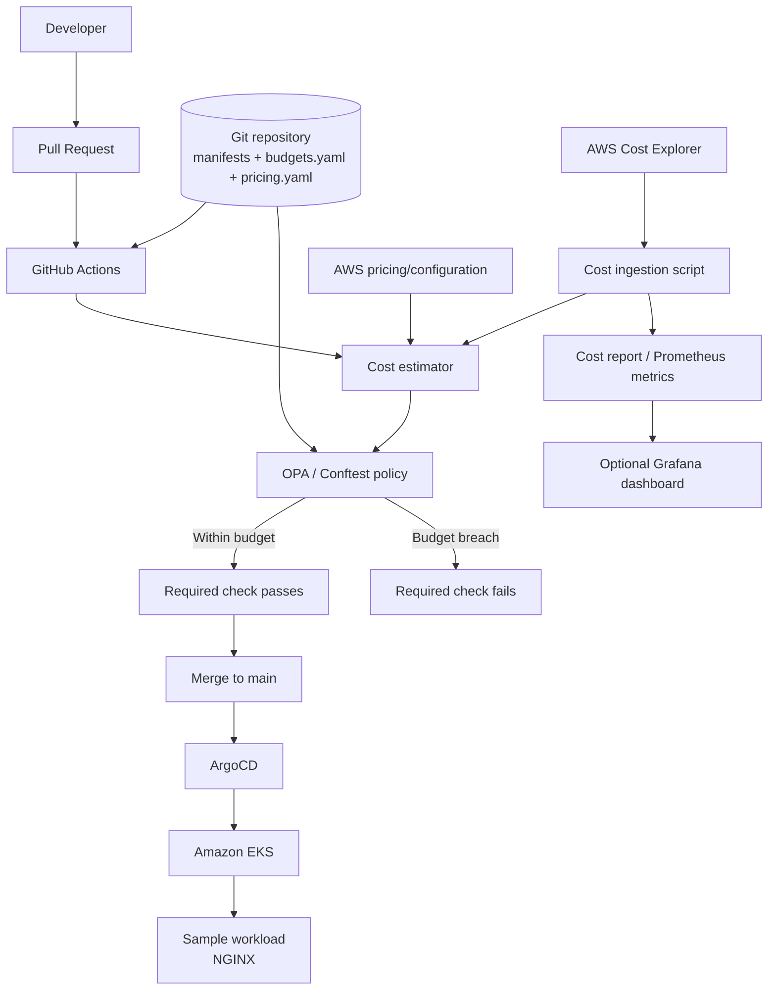

# Cost-Aware GitOps Gate

## 1. Project Summary

Cost-Aware GitOps Gate is a DevOps and FinOps control for Kubernetes deployments on
Amazon EKS. It estimates the cost impact of a Kubernetes manifest change during pull
request validation and compares the projected spend with a team or namespace budget.

The gate allows changes that remain within budget and blocks, flags, or requires an
auditable exception for changes that would exceed the budget.

This project does **not** require developing a web application. A small existing
container such as NGINX is used only as a representative workload. The main
deliverable is the infrastructure automation, GitOps workflow, policy enforcement,
cost estimation, and measurement of results.

## 2. Problem Statement

GitOps tools such as ArgoCD reliably deploy whatever is merged into the repository,
but a normal GitOps pipeline does not automatically evaluate the financial impact of a
change. A developer can unintentionally:

- Increase replicas substantially.
- Increase CPU or memory requests.
- Add persistent storage or a load balancer.
- Deploy a new workload without understanding its monthly cost.

The resulting cost may be discovered only after the AWS bill is generated. This
project adds a cost and budget decision before the change is merged and synchronized.

The goal is not to predict the exact AWS bill. The goal is to provide an early,
repeatable, and auditable control that catches material cost increases before they are
deployed.

## 3. What the Project Demonstrates

The project demonstrates:

1. Infrastructure provisioning with Terraform.
2. Kubernetes workload deployment on Amazon EKS.
3. GitOps synchronization with ArgoCD.
4. AWS cost ingestion and namespace/team attribution.
5. Cost estimation from Kubernetes resource requests and replicas.
6. Policy as code with OPA and Conftest.
7. Pull-request enforcement with GitHub Actions.
8. Approved exception handling.
9. Comparison of estimated cost with actual AWS cost.
10. Reporting through cost reports and, optionally, Grafana.

## 4. Architecture



## 5. Technology Stack

| Area | Technology |
|---|---|
| Infrastructure as code | Terraform |
| Cloud platform | AWS |
| Kubernetes | Amazon EKS |
| GitOps | ArgoCD |
| Sample workload | Existing NGINX container |
| Cost data | AWS Cost Explorer API |
| Pricing | Configured AWS rates or AWS Price List API |
| Estimation | Python |
| Policy | OPA and Conftest |
| CI/CD | GitHub Actions |
| Metrics | JSON/CSV reports and optional Prometheus |
| Visualization | Optional Grafana |

## 6. Prerequisites and Guardrails

- An AWS account with permission to create EKS, VPC, IAM, EC2, and related resources.
- AWS Cost Explorer enabled, with permission to read cost data.
- A GitHub repository and GitHub Actions enabled.
- Terraform, AWS CLI, `kubectl`, Helm, Python, OPA, and Conftest installed.
- A selected AWS region.
- A small, isolated demo environment.
- AWS Budgets and billing alerts configured as a safety net.
- A cost limit and teardown procedure documented before provisioning.
- GitHub OIDC authentication is preferred over long-lived AWS access keys.

The demonstration must use intentionally small resources and must destroy the demo
environment after testing. Cost Explorer data can lag by up to approximately 24 hours,
so the project must record the data timestamp and must not present the estimate as an
instantaneous bill.

## 7. Repository Structure

```text
cost-aware-gitops-gate/
├── infrastructure/
│   ├── main.tf
│   ├── variables.tf
│   ├── outputs.tf
│   └── terraform.tfvars.example
├── manifests/
│   ├── namespaces.yaml
│   ├── checkout-deployment.yaml
│   └── checkout-service.yaml
├── config/
│   ├── budgets.yaml
│   └── pricing.yaml
├── policies/
│   └── cost_gate.rego
├── scripts/
│   ├── ingest_costs.py
│   ├── estimate_cost.py
│   └── report.py
├── data/
│   └── .gitkeep
├── tests/
├── argocd/
│   └── application.yaml
└── .github/
    └── workflows/
        └── cost-gate.yaml
```

## 8. Budget and Pricing Configuration

`budgets.yaml` is the policy source of truth:

```yaml
namespaces:
  - name: team-checkout
    monthly_budget_usd: 30
    alert_threshold_pct: 80
  - name: team-search
    monthly_budget_usd: 50
    alert_threshold_pct: 80
```

Pricing must be explicit and versioned for reproducible estimates:

```yaml
pricing:
  cpu_core_hour_usd: 0.04
  memory_gb_hour_usd: 0.005
  hours_per_month: 730
```

The pricing adapter may later retrieve rates from the AWS Price List API. The
estimator must identify which rates and timestamp were used in every report.

## 9. Implementation Phases

### Phase 1 — Provision a small EKS baseline

- Create a VPC and private subnets with Terraform.
- Provision a small EKS cluster and node group.
- Configure IAM using least privilege.
- Apply consistent cluster, environment, and namespace/team tags.
- Configure local `kubectl` access.
- Configure an AWS Budget or billing alert for the demo account/environment.
- Validate the cluster and record its baseline cost assumptions.

**Output:** A small, working EKS environment with a documented teardown command.

### Phase 2 — Establish the baseline GitOps loop

- Create `team-checkout` and `team-search` namespaces.
- Deploy an existing NGINX image with resource requests and limits.
- Install ArgoCD with Helm.
- Register the Git repository as an ArgoCD application.
- Confirm that a normal manifest change synchronizes successfully.

No custom application code is required. The sample workload exists to create
realistic Kubernetes resource changes for the gate to evaluate.

**Output:** A working GitOps deployment before cost enforcement is enabled.

### Phase 3 — Implement cost attribution and ingestion

- Define the mapping between Kubernetes namespaces and AWS cost allocation tags.
- Apply the mapping through Terraform and Kubernetes metadata.
- Enable the required AWS cost allocation tags.
- Use AWS Cost Explorer `GetCostAndUsage` to retrieve spend.
- Group or filter costs by namespace/team tag where AWS data supports it.
- Store the result with amount, currency, namespace, time period, and data timestamp.
- Calculate and report unattributed spend.

Example report fields:

```json
{
  "namespace": "team-checkout",
  "current_spend_usd": 18.40,
  "period": "2026-10",
  "data_as_of": "2026-10-27T00:00:00Z"
}
```

**Output:** Current spend data and an attribution-coverage report.

### Phase 4 — Build the projected cost estimator

The Python estimator must compare the base and proposed manifests and report:

- Replica count before and after.
- Total requested CPU before and after.
- Total requested memory before and after.
- Estimated existing workload cost.
- Estimated proposed workload cost.
- Estimated monthly delta.
- Current spend.
- Projected monthly spend.
- Budget utilization before and after.
- Budget variance.

For the first version, the estimate may use:

```text
monthly workload cost =
replicas × requested CPU × CPU rate × hours per month
+ replicas × requested memory × memory rate × hours per month
```

The report must clearly state that this is an approximation. Shared node costs,
autoscaling, Spot capacity, storage, network transfer, discounts, and utilization
may cause actual costs to differ.

**Output:** A machine-readable JSON report and a human-readable pull-request summary.

### Phase 5 — Add the OPA budget policy

The policy must deny a change when:

```text
current_spend + projected_monthly_delta > namespace_budget
```

It must also validate:

- The namespace has a configured budget.
- Required CPU and memory requests exist.
- The namespace/team attribution is present.
- Any override contains the required approval metadata.

The policy result must include a clear reason, projected amount, budget, and amount
over budget. It must not silently pass when cost data or required input is missing.

**Output:** Passing and failing Conftest policy tests.

### Phase 6 — Integrate the CI cost gate

The GitHub Actions workflow must:

1. Check out the repository and the pull-request base revision.
2. Validate the Kubernetes manifests.
3. Retrieve current cost data.
4. Estimate the proposed cost.
5. Run Conftest.
6. Publish the summary and report as a pull-request check or artifact.
7. Fail the required check when the budget is exceeded.

Configure branch protection so that the cost gate is required before merging.

GitHub OIDC should be used for AWS authentication. The workflow must not store
long-lived AWS access keys in repository secrets.

**Output:** An over-budget pull request is blocked automatically.

### Phase 7 — Add exception and deployment-time protection

- Define an explicit override label such as `budget-exception-approved`.
- Require approval from an authorized reviewer.
- Record the reviewer, pull request, reason, timestamp, and projected excess.
- Prevent an override from bypassing missing or invalid cost data.
- Optionally add an ArgoCD PreSync hook that revalidates the current budget before sync.

The PreSync check is a second line of defense because a pull request may be approved
several days before it is deployed.

**Output:** A legitimate exception passes with an auditable `PASS WITH OVERRIDE` result.

### Phase 8 — Report actual impact

After an approved deployment has had time to appear in AWS billing data:

- Compare estimated monthly delta with observed AWS cost.
- Record absolute error and forecast error percentage.
- Record Cost Explorer data age.
- Record attribution coverage.
- Record whether the deployment caused a budget breach.

Grafana and Prometheus are optional. A JSON/CSV report is sufficient for the first
demonstration; a dashboard can be added after the data pipeline is reliable.

## 10. Demonstration Scenarios

### Scenario A — Within budget

```text
Current spend:             $18.40
Estimated monthly increase: $5.20
Projected spend:           $23.60
Budget:                    $30.00
Projected utilization:     78.7%
Decision:                  PASS
```

### Scenario B — Budget breach

```text
Current spend:             $18.40
Estimated monthly increase: $18.70
Projected spend:           $37.10
Budget:                    $30.00
Projected utilization:     123.7%
Decision:                  BLOCK
Budget excess:             $7.10
```

### Scenario C — Approved exception

```text
Projected spend:           $37.10
Budget:                    $30.00
Decision:                  PASS WITH OVERRIDE
Approval:                  Authorized platform reviewer
Audit record:              Pull request, reason, reviewer, timestamp
```

The pull request summary should also show what changed:

| Resource property | Before | After |
|---|---:|---:|
| Replicas | 2 | 6 |
| CPU request per pod | 250m | 500m |
| Memory request per pod | 256Mi | 1Gi |
| Total requested CPU | 500m | 3 cores |
| Total requested memory | 512Mi | 6Gi |

## 11. Metrics and Acceptance Criteria

The result must show more than a CI pass/fail status.

### Cost and budget metrics

- Current spend by namespace.
- Estimated monthly increase.
- Projected monthly spend.
- Budget utilization before and after.
- Budget variance.
- Untagged or unattributed spend.

### Control effectiveness metrics

- Total pull requests evaluated.
- Over-budget pull requests.
- Over-budget pull requests blocked.
- Unauthorized budget breaches.
- Approved overrides.
- False-pass count.
- Policy or data-availability failures.

Target for the controlled demonstration:

```text
Unauthorized over-budget changes blocked: 100%
False passes: 0
Attribution coverage: at least 95%
```

### Estimation quality metrics

For each deployed change:

```text
absolute error = abs(actual_delta - estimated_delta)

forecast error percentage =
abs(actual_delta - estimated_delta) / estimated_delta × 100
```

The project must report the error rather than claim exact prediction. A forecast error
below 20% can be used as an initial demonstration target, subject to the limitations
of the chosen workload and AWS billing data.

### Operational metrics

- Cost-gate execution time.
- Cost Explorer data age.
- AWS API failures.
- Missing tags.
- Policy evaluation failures.
- Override approval time.

### Example final result

```text
Namespace:                 team-checkout
Monthly budget:            $30.00
Current spend:             $18.40
Estimated increase:        $18.70
Projected spend:           $37.10
Budget utilization:        123.7%
Budget variance:           -$7.10
Gate decision:              BLOCKED
Attribution coverage:      96.1%
Cost data age:             18 hours
Forecast error:             8.4%
```

## 12. Validation Checklist

- [ ] Terraform provisions the isolated demo environment.
- [ ] AWS billing alert or budget is configured.
- [ ] ArgoCD deploys the baseline NGINX workload.
- [ ] Namespace/team tags are present.
- [ ] Current AWS cost is ingested successfully.
- [ ] Attribution coverage is reported.
- [ ] A within-budget pull request passes.
- [ ] An over-budget pull request fails and blocks merge.
- [ ] The failure explains the resource change and projected cost.
- [ ] An authorized override is auditable.
- [ ] ArgoCD does not synchronize an unauthorized over-budget change.
- [ ] Estimated cost is compared with actual AWS cost after billing data is available.
- [ ] The demo environment is destroyed after testing.

## 13. Limitations and Trade-offs

- Resource-request-based estimation is an approximation, not an exact billing forecast.
- AWS Cost Explorer data is delayed and may not reflect the latest deployment immediately.
- Namespace attribution depends on correct tagging and allocation of shared resources.
- Shared node, control-plane, storage, networking, discount, and autoscaling costs may
  need separate allocation rules.
- A strict gate can slow delivery, so an auditable exception process is necessary.
- Real AWS costs should be kept low by using a small cluster, short test windows, and
  prompt teardown.

## 14. Final Project Statement

> Cost-Aware GitOps Gate is a DevOps and FinOps control that estimates the financial
> impact of Kubernetes resource changes during pull-request validation, compares
> projected spend with namespace budgets, and prevents or flags unauthorized
> budget-breaching deployments before ArgoCD synchronizes them to Amazon EKS.

The project uses a real AWS environment for demonstration, but the sample workload is
deliberately simple. The value is in the automation, policy enforcement, cost
attribution, GitOps integration, and measurable evidence that the gate controls
deployment risk.
